# ShadowWalkerNC Ecosystem Architecture

Canonical Architecture, System Topology, and Boundary Specifications  
Repository: ShadowWalkerNC/.github  
Date: October 17, 2026  
Status: Active Canonical Reference  

---

## 1. Executive Architecture Summary

The ShadowWalkerNC development universe represents a multi-tiered engineering ecosystem structured under a single unified umbrella. Rather than forcing independent projects into a single monolithic repository or leaving them in fragmented isolation, the architecture enforces logical ownership, contract-first boundaries, and explicit integration patterns.

The two primary strategic pillars of the ecosystem are:
1. Developer Intelligence & Orchestration: ForgeSatchel (control plane), JOSH (System 1 intelligence engine), and Muse (experimentation and agent execution).
2. CulinaryOS Suite: CulinaryOS Core (restaurant operations platform) and ShorelineOps (clinical dietary and healthcare operations), enriched by modular capability sources.

Surrounding these pillars are Independent Products (such as Mercury, Sigil, BibleDesk, and Dominion), Client & Business Deliverables (such as Cheezies Gourmet and Ryan's Stream Portal), Shared Engineering Standards, and Platform Operations.

---

## 2. Canonical Target Hierarchy

```text
ShadowWalkerNC/
|
|-- 01-developer-intelligence/
|   |-- ForgeSatchel (Development Control Plane)
|   |-- JOSH (System 1 Intelligence Engine)
|   |-- MuseLab (AI Experimentation and Benchmarks)
|   |-- ShadowHelicon (Agent Workbench and GUI)
|   |-- Muse SDK Integrations (muse-code-sdk, muse-gadget-sdk)
|   `-- AI and Tool Orchestration (system-one, ai-clis)
|
|-- 02-culinaryos-suite/
|   |-- CulinaryOS Core (Canonical Restaurant Monorepo)
|   |-- ShorelineOps (Clinical Healthcare Dietary Operations)
|   |-- KitchenKit (Prep Planning and Recipe Blueprint Engine)
|   |-- RecipeOS (Recipe Capability Source - Absorbed)
|   |-- CulinaryOps (Labor, Cost, and Vendor Operations)
|   |-- Plated (Web Storefront and CMS Capability)
|   |-- Post-Pilot (Marketing and Social Publishing Capability)
|   `-- Restaurant Intelligence (CulinaryOS Addons / RestRevive-AI)
|
|-- 03-independent-products/
|   |-- Mercury (Self-Hosted Communications Platform)
|   |-- Sigil / OpenForge (Workspace and Project Intelligence Platform)
|   |-- BibleDesk (5-Dimensional AI Theological Study Platform)
|   |-- Dominion (Unity Strategic Simulation Engine)
|   |-- Emergency-CAD (Modern Kotlin Multiplatform Dispatch)
|   |-- EMSCAD (Legacy PHP/MySQL Tickets CAD Reference)
|   |-- MosaicBit (Geometric Data Matrix Art Engine)
|   |-- prayer-atlas (Missions and Location Prayer Platform)
|   `-- ASCILINE-2.0 (Real-Time Binary ASCII Video Engine)
|
|-- 04-client-and-business-projects/
|   |-- Cheezies Gourmet (Production Food Truck Application)
|   |-- Ryan's Website (dark-phoneix-clips Creator Portal)
|   |-- The Wilted Rose (Personal Chef and Catering Profile)
|   |-- Northern Fixin's (Food Truck Profile)
|   |-- Seasons Bar & Grille (Hospitality Client Profile)
|   `-- Demonstration Sites (Benjamins, Joe's Tacos)
|
|-- 05-shared-engineering/
|   |-- Common Contracts and Schemas (.github/schemas)
|   |-- Standard Constitutions and Policies (.github/standards)
|   |-- ScriptC (Native TypeScript Compiler Tooling)
|   |-- Antigravity SDK & Tools (Local AI Models & MCP Drivers)
|   `-- Reusable Packages (@helicon/mcp, @openforge/sdk)
|
`-- 06-platform-operations/
    |-- Governance and Portfolio Specs (ShadowWalkerNC/.github)
    |-- Portfolio Showcase Web (ShadowWalkerNC/portfolio)
    |-- Security, Approval, and Secret Models (.github/security)
    |-- CI/CD Workflows and Automated Governance
    `-- Backup, Observability, and Audit Registries
```

---

## 3. System Topology Diagram

The following Mermaid diagram visualizes the runtime and development-time relationships across all tiers of the ecosystem:

```mermaid
flowchart TD
    subgraph S01["01 - Developer Intelligence & Orchestration"]
        FS["ForgeSatchel\n(Developer Control Plane)"]
        JOSH["JOSH\n(System 1 Deterministic Engine)"]
        SH["ShadowHelicon\n(Agent GUI Workbench)"]
        ML["MuseLab\n(AI Experimentation Lab)"]
        MSDK["Muse SDKs\n(Code & Gadget Drivers)"]
        
        FS <-->|"Policy & Decision Queries"| JOSH
        SH -->|"Contract Hook / Policy"| JOSH
        SH -->|"Registration / Secrets"| FS
        SH -->|"Spawns MSP Host"| MSDK
        ML -->|"Promotes Proven Artifacts"| FS
    end

    subgraph S02["02 - CulinaryOS Suite"]
        COS["CulinaryOS Core\n(Turborepo Monorepo)"]
        SHORE["ShorelineOps\n(Clinical Dietary OS)"]
        KK["KitchenKit\n(Prep & Scaling Engine)"]
        COPS["CulinaryOps\n(Labor & Cost Ops)"]
        PLT["Plated\n(Web & CMS Engine)"]
        PP["Post-Pilot\n(Marketing Engine)"]
        CINT["CulinaryOS Intelligence\n(AI Operations Addon)"]
        
        COS <-->|"Authenticated REST/Events\n(Strict Data Isolation)"| SHORE
        KK -.->|"Prep / Recipe Module Source"| COS
        COPS -.->|"Operations Module Source"| COS
        PLT -.->|"Web / Storefront Source"| COS
        PP -.->|"Social Marketing Source"| COS
        CINT -.->|"Operations Skills Provider"| COS
    end

    subgraph S03["03 - Independent Products"]
        MERC["Mercury\n(Messaging Platform)"]
        SIG["Sigil / OpenForge\n(Orchestration Engine)"]
        BD["BibleDesk\n(Theological AI)"]
        DOM["Dominion\n(Unity Simulation)"]
        ECAD["Emergency-CAD\n(KMP Dispatch)"]
        MBIT["MosaicBit\n(Rust Visual Matrix)"]
    end

    subgraph S04["04 - Client & Business Deliverables"]
        CHZ["Cheezies Gourmet\n(Food Truck App)"]
        RYAN["Ryan's Website\n(Stream Portal)"]
        WROSE["The Wilted Rose\n(Catering Profile)"]
        NFIX["Northern Fixin's\n(Food Truck Profile)"]
        
        CHZ -.->|"Validates Web/POS"| COS
    end

    subgraph S05["05 - Shared Engineering & 06 - Operations"]
        GOV["ShadowWalkerNC/.github\n(Governance, Schemas & ADRs)"]
        SCRIPTC["ScriptC\n(Native TS Compiler)"]
        MCP_STDS["Standard Schemas\n(JSON Schemas & MCP Contracts)"]
        
        GOV -->|"Standards & Schemas"| FS
        GOV -->|"Standards & Schemas"| COS
        GOV -->|"Standards & Schemas"| SHORE
        GOV -->|"Standards & Schemas"| SIG
        SCRIPTC -->|"Native Binaries"| FS
        MCP_STDS -->|"Contract Validation"| S01
    end
```



---

## 4. Architectural Boundaries and Ownership Rules

### 4.1 Developer Intelligence Boundaries
1. ForgeSatchel is the authoritative developer control plane on the machine. It manages workspaces, Git worktrees, task execution, tool authority, and development workflows. It does not perform fast statistical intent classification.
2. JOSH is the System 1 deterministic-first intelligence engine. It specializes in fast probabilistic intent routing, trigger recognition, and policy validation. JOSH never mutates machine files, executes unapproved shell tasks, or stores machine master authority. JOSH is not an oversized LLM wrapper.
3. MuseLab is strictly bounded as an R&D and incubation lab. Experimental dependencies and test harnesses remain isolated until proven through rigorous benchmarking.
4. ShadowHelicon is the desktop and mobile agent GUI workbench, orchestrating Muse sessions via `@muse-code/sdk` and querying JOSH for policy decisions.

### 4.2 CulinaryOS Suite Boundaries
1. CulinaryOS Core and ShorelineOps belong to the same parent suite and LLC corporate umbrella.
2. ShorelineOps maintains absolute clinical data isolation, distinct HIPAA compliance boundaries, and separate deployment lifecycles. It never shares an unmediated database connection or raw user tables with CulinaryOS Core.
3. Capability projects (KitchenKit, RecipeOS, CulinaryOps, Plated, Post-Pilot, RestRevive-AI) represent modular capability sources. Working features migrate into CulinaryOS Core through verified module interfaces, leaving the source repositories as immutable rollback references.

### 4.3 Independent Products & Client Boundaries
1. Independent products (Mercury, BibleDesk, Dominion, Emergency-CAD, Sigil, MosaicBit) serve specific dedicated audiences and retain independent codebases, licenses, and release schedules.
2. Client deliverables (Cheezies Gourmet, Ryan's Portal) maintain customer-specific data, credentials, and hosting boundaries. Business-specific workflows remain adapters or plugins rather than polluting the core platforms.
